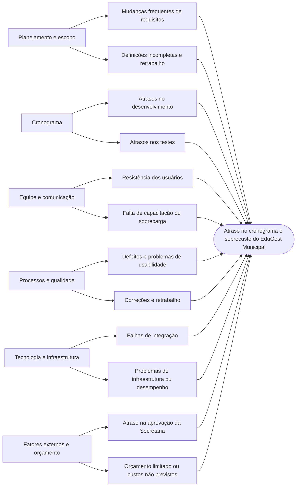

## 1. Visão geral

O **EduGest Municipal** é uma proposta de sistema web integrado de gestão escolar para a Escola Municipal de Hidrolândia. O projeto busca modernizar e centralizar processos acadêmicos e administrativos que atualmente são realizados manualmente, como matrículas, lançamento de notas, controle de frequência, geração de relatórios e comunicação com os responsáveis.

A centralização dessas informações tem como objetivos reduzir atrasos e erros, aumentar a transparência, automatizar relatórios e melhorar a comunicação entre escola, alunos e responsáveis.

## 2. Objetivos do projeto

- Centralizar informações acadêmicas e administrativas em um sistema web.
- Automatizar o cadastro de alunos, o lançamento de notas e o controle de frequência.
- Disponibilizar relatórios gerenciais.
- Facilitar o acesso dos responsáveis às informações acadêmicas.
- Melhorar a eficiência dos processos escolares e reduzir o retrabalho.

## 3. Funcionalidades previstas

- **Matrículas:** cadastro e gerenciamento de alunos.
- **Notas:** lançamento e consulta de notas.
- **Frequência:** registro e acompanhamento da presença dos alunos.
- **Relatórios:** geração de informações para acompanhamento da gestão escolar.
- **Comunicação:** apoio ao acesso dos responsáveis às informações acadêmicas.

### Requisitos não funcionais

O relatório destaca requisitos de segurança, acessibilidade, desempenho, confiabilidade e compatibilidade. Entre os critérios propostos estão:

- Tempo médio de resposta inferior a 3 segundos nas principais operações.
- Taxa mínima de sucesso de 85% nos testes de usabilidade.
- Disponibilidade mínima de 98%.
- Autenticação obrigatória para acesso às informações acadêmicas.
- Validação nos principais navegadores utilizados pela instituição.

## 4. Escopo

### Dentro do escopo

- Planejamento e levantamento de requisitos.
- Modelagem e prototipação.
- Desenvolvimento dos módulos de matrículas, notas, frequência e relatórios.
- Testes funcionais e de usabilidade.
- Treinamento dos usuários e implantação.

### Fora do escopo

- Gestão financeira da escola.
- Folha de pagamento de professores.
- Integração com sistemas externos da prefeitura.

## 5. Metodologia e ciclo de vida

O projeto adota um ciclo de vida **iterativo-incremental com práticas ágeis**, permitindo evolução a partir do feedback de professores e gestores. O relatório menciona o uso de Planning Poker para estimativas de esforço.

As atividades seguem, em linhas gerais, esta sequência:

1. Levantamento de requisitos.
2. Modelagem do sistema e protótipo.
3. Desenvolvimento dos módulos.
4. Testes integrados.
5. Treinamento dos usuários.
6. Implantação.

Os módulos principais podem ser desenvolvidos em paralelo após a etapa de modelagem e prototipação, enquanto os testes integrados dependem da conclusão dos módulos.

## 6. Stakeholders

| Stakeholder | Papel ou estratégia de engajamento descrita no relatório |
|---|---|
| Direção da escola | Patrocinadora; deve ser mantida satisfeita e alinhada ao projeto. |
| Secretaria de Educação | Órgão regulador e parte importante das aprovações; deve ser gerenciada de perto. |
| Professores | Usuários principais; devem permanecer próximos do desenvolvimento e fornecer feedback. |
| Alunos | Beneficiários do sistema; devem receber informações relevantes. |
| Responsáveis | Consultam informações acadêmicas; devem ser mantidos informados. |

## 7. Cronograma e estimativas de custo

O relatório apresenta uma duração aproximada de **38 dias**, identificada por meio da análise do caminho crítico (CPM). A sequência crítica descrita é:

**Levantamento de Requisitos → Modelagem do Sistema → Desenvolvimento do Módulo de Matrículas → Testes Integrados → Treinamento → Implantação.**

As estimativas de custo registradas são:

| Técnica | Custo estimado |
|---|---:|
| Estimativa análoga | R$ 40.000,00 |
| Estimativa paramétrica | R$ 38.000,00 |
| Estimativa Bottom-Up | R$ 47.000,00 |

A estimativa Bottom-Up foi escolhida como referência orçamentária por considerar os pacotes de trabalho de forma mais detalhada.

## 8. Monitoramento de custos e prazos

Os indicadores de Valor Agregado apresentados no relatório apontam desvios em relação ao planejamento:

| Indicador | Valor apresentado | Interpretação no relatório |
|---|---:|---|
| PV — Valor Planejado | R$ 37.000 | Valor do trabalho que deveria ter sido realizado até a data analisada. |
| EV — Valor Agregado | R$ 31.450 | Valor do trabalho efetivamente concluído, abaixo do planejado. |
| AC — Custo Real | R$ 41.000 | Custo incorrido até a data analisada. |
| SPI — Índice de Desempenho de Prazo | 0,85 | Indica atraso em relação ao planejado. |
| CPI — Índice de Desempenho de Custos | 0,77 | Indica eficiência de custos inferior à prevista. |
| EAC — Estimativa de Custo ao Término | R$ 61.299 | Projeção de custo final superior ao orçamento de R$ 47.000. |
| TCPI | 2,59 | O relatório considera pouco realista concluir dentro do orçamento original sem ações corretivas relevantes. |

A projeção EAC representa um excedente aproximado de **R$ 14.299** em relação ao orçamento aprovado. O relatório recomenda revisar o planejamento do desenvolvimento, controlar os custos restantes, avaliar o escopo não crítico e considerar o replanejamento do orçamento.

## 9. Gestão da qualidade

O projeto utiliza características da norma **ISO/IEC 25010** como referência para avaliar adequação funcional, usabilidade, desempenho, confiabilidade, segurança e compatibilidade.

O ciclo **PDCA** orienta a melhoria contínua:

- **Plan (Planejar):** definir requisitos, métricas, critérios de aceitação e testes.
- **Do (Executar):** desenvolver os módulos e realizar as atividades planejadas.
- **Check (Verificar):** comparar resultados com metas e indicadores.
- **Act (Agir):** implementar ações corretivas e preventivas.

## 10. Equipe e comunicação

O relatório propõe uma equipe fictícia de oito profissionais: Gerente de Projeto, Analista de Requisitos, UX/UI Designer, Desenvolvedores Full Stack, QA, DevOps e Suporte/Treinamento.

Para uma equipe de oito integrantes, a fórmula `n(n - 1) / 2` resulta em **28 canais potenciais de comunicação**. O Gerente de Projeto é descrito como o principal ponto de integração, com reuniões, relatórios de status e comunicação periódica com os stakeholders.

## 11. Gestão de riscos

A Estrutura Analítica de Riscos (RBS) agrupa os riscos em oito categorias: escopo, cronograma, custos, qualidade, técnico, segurança, recursos humanos e fatores externos.

Entre os riscos destacados no relatório estão:

- Mudanças frequentes de requisitos.
- Atrasos no desenvolvimento e nos testes.
- Resistência dos usuários.
- Falhas de qualidade e usabilidade.
- Estouro do orçamento.
- Falhas de integração, infraestrutura ou desempenho.
- Vazamento de dados e acessos indevidos.
- Sobrecarga ou falta de capacitação da equipe.
- Atraso na aprovação da Secretaria de Educação.

Na matriz Probabilidade × Impacto, as mudanças frequentes de requisitos (R01) e os atrasos no desenvolvimento (R02) aparecem como riscos críticos, ambos com pontuação 20. O relatório também classifica como críticos os riscos de falhas de qualidade (R04), estouro do orçamento (R05) e falhas de integração (R09).

## 12. Diagrama de Ishikawa

O relatório inclui a seção “Diagrama de Ishikawa”, mas não apresenta, no conteúdo textual disponível, a descrição das causas detalhadas do diagrama. Por isso, o diagrama sugerido abaixo usa os problemas e riscos mencionados no próprio relatório para organizar **causas potenciais a investigar**, sem afirmar que todas foram comprovadas.

**Problema analisado:** atraso no cronograma e sobrecusto do projeto.

### Interpretação do Ishikawa

- **Planejamento e escopo:** mudanças de requisitos ou definições incompletas podem gerar retrabalho e aumentar o esforço.
- **Cronograma:** atrasos no desenvolvimento ou nos testes podem afetar a data de implantação, especialmente quando envolvem atividades do caminho crítico.
- **Equipe e comunicação:** resistência à adoção, capacitação insuficiente ou sobrecarga podem dificultar o andamento das atividades.
- **Processos e qualidade:** defeitos e problemas de usabilidade podem exigir correções e novos testes.
- **Tecnologia e infraestrutura:** falhas de integração e problemas de desempenho podem comprometer o funcionamento dos módulos.
- **Fatores externos e orçamento:** aprovações institucionais e custos não previstos podem afetar o prazo e o orçamento.

**Observação:** essas relações são hipóteses para orientar a análise de causa-raiz. Para confirmar as causas, é necessário verificar registros do projeto, conversar com a equipe e comparar os dados reais de execução com o planejamento.

## 13. Conclusão

O EduGest Municipal propõe centralizar processos escolares e aumentar a eficiência da gestão. O planejamento contempla escopo, stakeholders, cronograma, custos, qualidade, comunicação e riscos. Entretanto, os indicadores de Valor Agregado apresentados mostram atraso e sobrecusto projetado, tornando prioritários o acompanhamento do caminho crítico, a análise das causas dos desvios e a implementação de ações corretivas.

## 14. Fonte

Conteúdo elaborado com base no documento **Relatório 02 — Gestão de Projetos de Software / Projeto Integrador Individual**, referente ao projeto EduGest Municipal.
_EduGest_Municipal.md…]()
